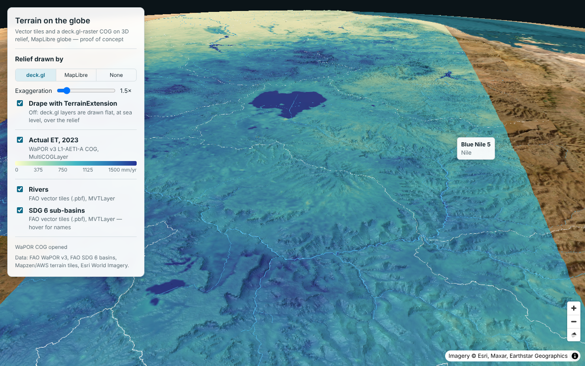

# AQUASTAT terrain — proof of concept

Can we show vector tiles and deck.gl-raster COGs **on 3D terrain, on the globe**?
**Yes**, if deck.gl draws the terrain itself. Our layers can't follow MapLibre's terrain.



The setup is the same as in globe-poc and water-portal: MapLibre globe with a deck.gl
`MapboxOverlay` (interleaved, `GlobeView`). On top of it:

| Layer | What | How |
|---|---|---|
| Terrain | AWS/Mapzen terrarium DEM tiles, Esri World Imagery as texture | deck.gl `TerrainLayer`, `operation: "terrain+draw"` |
| Raster | WaPOR v3 L1-AETI-A 2023 (300 m, global COG, 5 GB) | `MultiCOGLayer` + `TerrainExtension` |
| Vector | FAO rivers and SDG 6 sub-basins (`.pbf` from `fao-cog-data`) | `MVTLayer` + `TerrainExtension` |

The panel switches between three ways to draw the relief:

- **deck.gl**: the setup above. The raster and vector tiles are draped on the relief,
  and hovering a sub-basin picks it through the terrain.
- **MapLibre**: `map.setTerrain()` with the same DEM. MapLibre's own layers follow the
  relief. deck.gl layers don't: the overlay only gets the camera from MapLibre
  (`@deck.gl/mapbox` reads the terrain to place the camera, not to get heights). They
  are drawn flat, over the relief.
- **None**: flat globe, as in globe-poc.

*Drape with TerrainExtension* turns the draping off in deck.gl mode, so you can compare.

## Run

```bash
npm install        # also applies patches/ via patch-package
npm run dev        # http://localhost:5173
```

All sources send CORS headers, so no proxy is needed.

## Things this PoC surfaced

- **deck.gl 9.4 supports terrain on `GlobeView`.** `TerrainLayer` and
  `TerrainExtension` both have globe code paths. Draping works in interleaved mode.
- **The raster has to be draped explicitly.** `TerrainExtension` guesses the draw mode
  from the layer. deck.gl-raster draws tiles as an instanced mesh, which looks like a
  3D object to the extension, so it lifts the raster to terrain height (`offset`). The
  raster then z-fights with the terrain mesh and comes out speckled.
  `terrainDrawMode: "drape"` on the `MultiCOGLayer` fixes this.
- **Draped tiles don't show up when they load** (deck.gl gap). `TerrainExtension`
  renders draped layers into a texture per terrain tile and only redraws that texture
  when a draped layer changes. A `TileLayer` shows a loaded tile by filtering its
  sub-layers at draw time, which doesn't change any layer. So a raster tile stays
  invisible until the camera moves. `redrawDrape()` in `src/main.ts` works around this
  by marking the textures stale on each `onTileLoad`. It reaches into deck.gl
  internals; it's a candidate upstream fix. The vector tiles have the same issue, but
  they usually load before the first draw.
- **deck.gl-raster picks far too many tiles on a globe**: 15,505 at zoom 8 for WaPOR.
  water-portal already works around this, and `src/globe-cog-layer.ts` is a trimmed
  copy of its `GlobeMultiCOGLayer`, plus a cap of 64 tiles for pitched views. With it,
  the same view needs 24 tiles. This happens with or without terrain.
- **Draping fixes the tile-edge outlines.** Flat on the globe, `MVTLayer` doesn't clip
  its tiles (see globe-poc), so stroked polygons outline every tile edge (the straight
  white lines in *MapLibre* and *None* mode). Draped layers are drawn into Web Mercator
  textures, where the clipping works, and the lines disappear.
- **The band-interleaved TIFF patch from globe-poc is needed for WaPOR too.**
- **Changing the exaggeration reloads all terrain tiles.** It's built into the height
  decoder, and `TerrainLayer` has no exaggeration uniform. That's fine for a setting,
  not for a slider you drag. The decoder object is also memoised: a new one on every
  render would reload the terrain each time any layer changes.
- `MultiCOGLayer` reopens its COGs whenever it gets a new `sources` object, so that is a
  module-level constant.
- **Not measured: performance on a real GPU.** These tests ran in headless Chromium
  with software WebGL (SwiftShader), where everything is slow. Globally dense vector
  tiles (rivers at zoom 3) were the heaviest part, with or without terrain.

## Layout

| Path | What |
|---|---|
| `src/main.ts` | Map, layers, terrain modes, controls |
| `src/globe-cog-layer.ts` | `MultiCOGLayer` with globe-aware tile selection (from water-portal) |
| `src/aeti-shader.ts` | WaPOR AETI scaling, nodata and colour ramp |
| `patches/` | deck.gl-geotiff: accept single-band band-interleaved TIFFs (as in globe-poc) |
