# FAO Water Portal (review): inventory of graphs/plots

Source: https://waterportal.review.fao.org, captured 2026-10-24.
Chart definitions were read from the catalog config (`/init/country.json`, `/init/basin.json`, `/init/local.json`), the popup templates and the JS bundle. Screenshots were taken with headless Chrome at 1600×1000.

Screenshot settings:
- **Country domain:** year 2023, in World view and with **Egypt** selected.
- **Basin domain:** default date range 2026‑01‑01 → 2026‑10‑31, in World view, with the **Nile** major basin selected, and with the **Blue Nile 1** sub-basin selected.

## How the site is organised

| Level | What it is |
|---|---|
| **Domain** (top switch) | `Country` (default) · `Basin` · `Local` |
| **Tab** | Country: Water resources · Water use · Irrigation · **SDG 6.4** (default). Basin: Major Basins · Sub-basins · Rivers (hidden). Local: Climate · Biomass Production · Infrastructure |
| **Map** | One main layer per tab (choropleth or raster) with a style picker, a time slider, and "compare" layers (IPC, ESA WorldCover, GLW4 livestock, WorldPop) |
| **Dashboard panel** | KPI banners + charts. Each chart is shown in the **World** view, the **Selected** view (a country or basin is picked), or both |

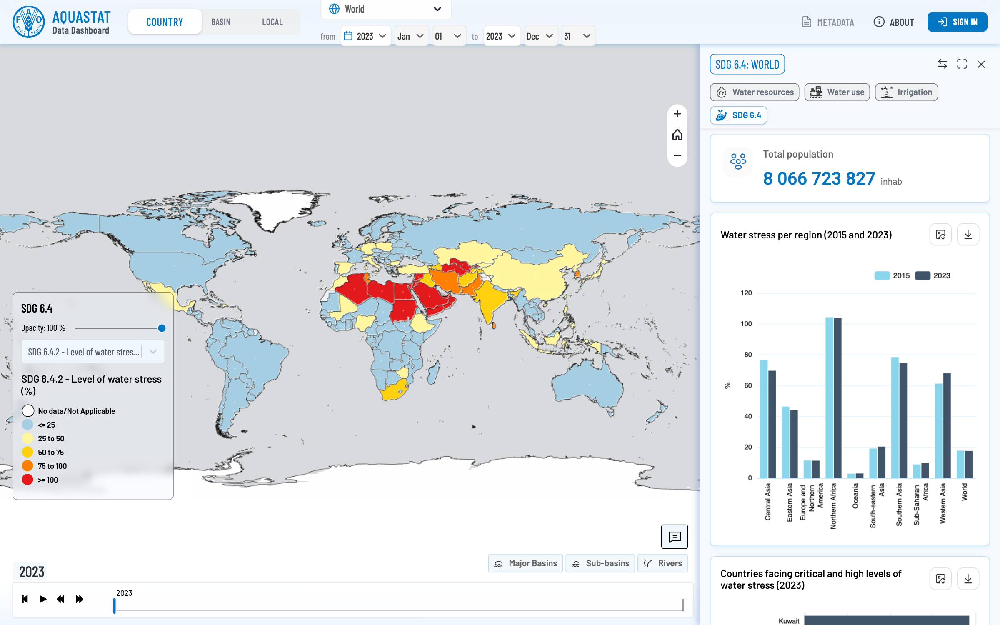

**Data API.** Charts fetch `/waterportal?key=<endpoint>&…`:
- `key=snapshot&country=&year=&variables=…`: values of AQUASTAT variables for one country and year.
- `key=multivariateTimeseries&country=&year=&fromYear=&variables=…`: a time series of AQUASTAT variables.
- Named keys (e.g. `trwrpcRegional`, `waterStressPerRegion`, `basinPrecipitation`): precomputed regional, top‑N or basin tables.

Map choropleths come from BigQuery SQL views over `fao-maps.fao_aquastat_dissemination.mvw_aquastat` (country) and the basin water-balance tables.

### Principles behind the map suggestions

Each chart below has a **Suggested map** line. The suggestions follow four rules:
1. **Same indicator, same unit.** When a chart is in focus, the map shows the variable the chart is about, in the chart's units.
2. **Same spatial unit.** Regional charts get country maps with region outlines, and basin rankings get basin maps.
3. **Linked interaction.** Hovering a bar or slice highlights the matching countries or basins on the map. Clicking a year or date on a time-series chart moves the map's time slider.
4. **Reuse what exists.** Each suggestion says whether an existing map style already covers it (✅ exists), or whether a new style or layer is needed (➕ new).

---

## 1. Country domain

All four tabs show 3 KPI banners: Total, Urban and Rural population (`snapshot`, ×1000). Extra banners per tab are listed below.

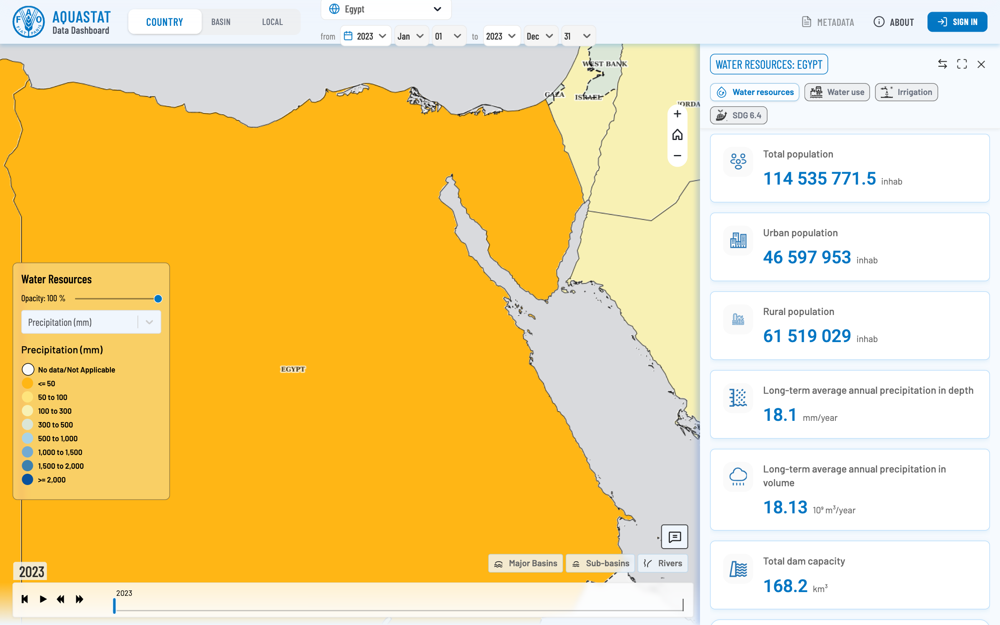

### 1.1 Water resources tab

**Current map styles:** `precipitation` (mm), `total_renewable` (mm), `irwr` (mm), `dependency_ratio` (%), `trwrpc` (m³/inhab/yr). The map defaults to Precipitation.
**Extra banners:** Long-term avg annual precipitation (depth, mm/yr; volume, 10⁹ m³/yr) · Total dam capacity (km³).

#### WR1 · Total renewable water resources per capita per region (2015–2023)
- **Type / view:** grouped bar (x = region, series = 2015 vs 2023) · World only
- **Shows:** TRWR per capita for the World and the SDG regions.
- **Data:** `key=trwrpcRegional` → {region, year, value m³/inhab/yr}
- **Suggested map:** ✅ `trwrpc` choropleth for 2023, with SDG-region outlines. Hovering a region's bar highlights its countries. Optionally add ➕ a "change 2015→2023 (%)" style to match the two-year comparison.

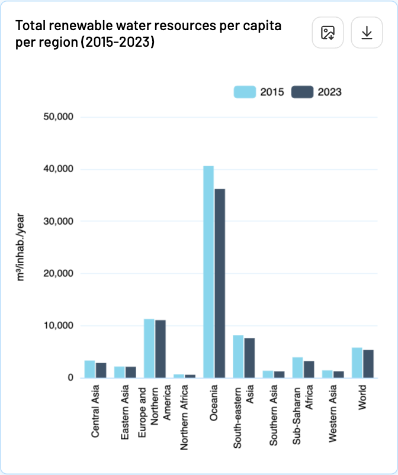

#### WR2 · Top countries with lowest total renewable water
- **Type / view:** horizontal bar, sorted · World only
- **Shows:** countries with the lowest TRWR per capita (Kuwait, UAE, Qatar, Yemen…).
- **Data:** `key=lowestTrwrpc` → {country, year, value}
- **Suggested map:** ✅ `trwrpc` choropleth, but ➕ with water-scarcity class breaks (Falkenmark: <500 / 500–1000 / 1000–1700 / >1700 m³). Outline the listed countries, because they are small and nearly invisible on a world map. Add point markers or a zoom-to-Gulf inset.

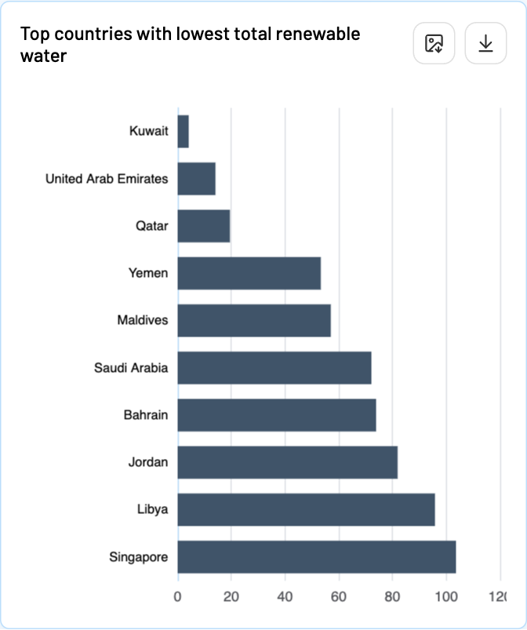

#### WR3 · Renewable water resources (internal vs external)
- **Type / view:** donut · World + Country. ⚠️ It **did not render in World view**; the screenshot is for Egypt.
- **Shows:** IRWR vs external renewable water. Egypt: 98 % external.
- **Data:** `snapshot`: *Total internal renewable water resources (IRWR)*, *Water resources: total external renewable*
- **Suggested map:** ✅ `dependency_ratio` choropleth (% from outside the country). For a selected country, ➕ overlay its transboundary basins (✅ Major basins layer) and highlight the upstream countries.

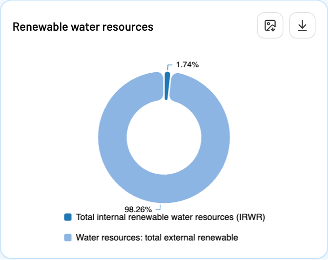

#### WR4 · Renewable water resources by source (surface vs groundwater)
- **Type / view:** donut · World + Country. ⚠️ It **did not render in World view**; the screenshot is for Egypt.
- **Data:** `snapshot`: *Total renewable surface water*, *Total renewable groundwater*
- **Suggested map:** ➕ "Groundwater share of TRWR (%)" choropleth. For a selected country, ➕ a major aquifer layer (e.g. WHYMAP) for context.

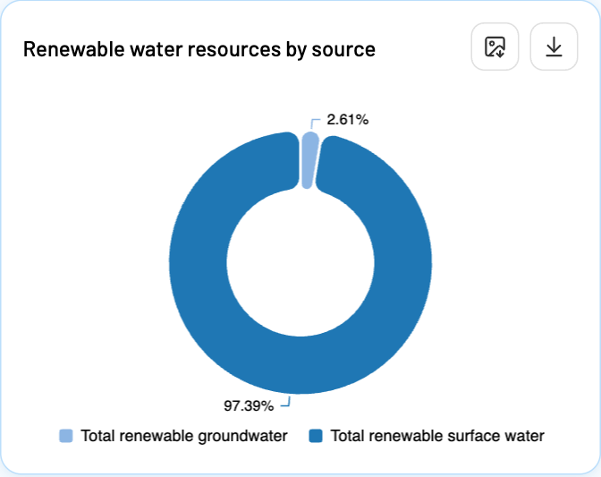

#### WR5 · Total renewable water resources per capita (time series)
- **Type / view:** bar time series · World + Country
- **Data:** `multivariateTimeseries`: *Total renewable water resources per capita*
- **Suggested map:** ✅ `trwrpc` choropleth with the time slider linked to the chart. Clicking a bar sets the map year. This is the clearest case for chart-to-map time sync.

| World | Egypt |
|---|---|
| 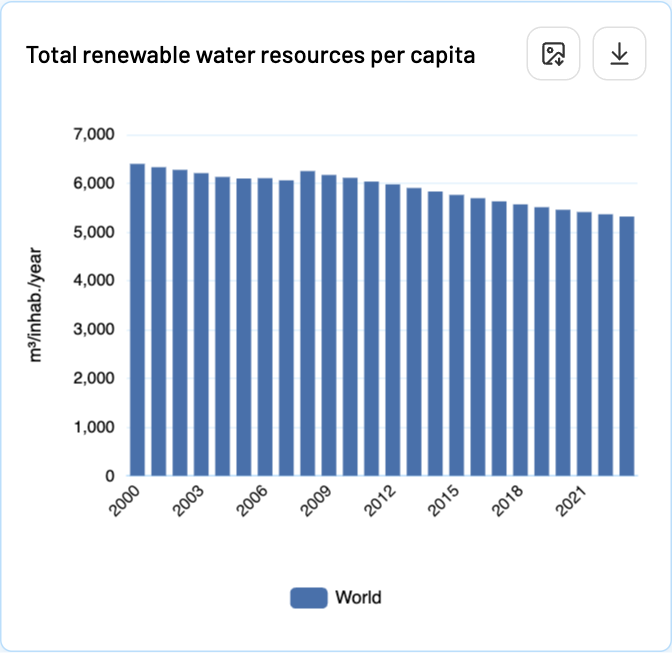 | 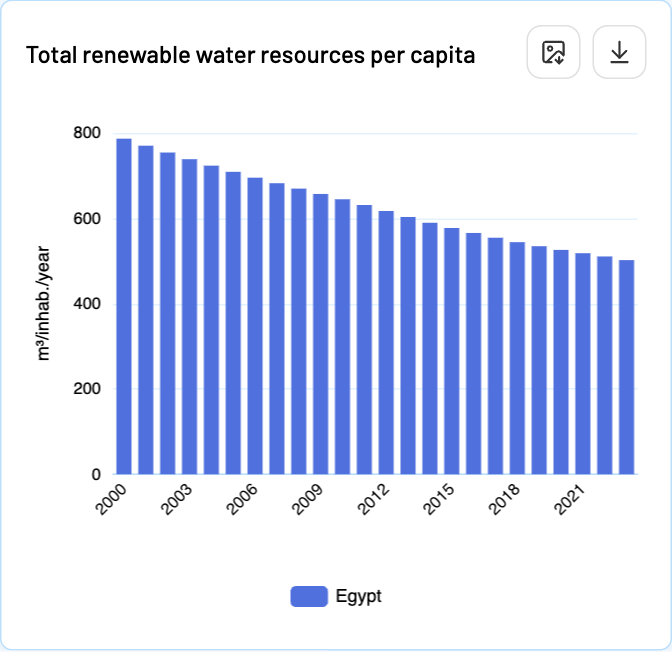 |

### 1.2 Water use tab

**Current map styles:** `twpc`, `awpc`, `iwpc`, `mwpc` (total, agri, industrial and municipal withdrawal per capita, m³/inhab/yr), `aw_pct` (% agricultural).
**Extra banner:** Total water withdrawal (10⁹ m³/yr).

#### WU1 · Total freshwater withdrawal per region (2015 and 2023)
- **Type / view:** horizontal grouped bar · World only
- **Data:** `key=totalFreshwaterWithdrawalRegional&year=` (10⁹ m³/yr)
- **Suggested map:** ➕ proportional circles of total withdrawal volume per country. Use circles because absolute volumes suit symbols better than a choropleth. Overlay region outlines. ✅ `twpc` is the fallback if only choropleths are possible.

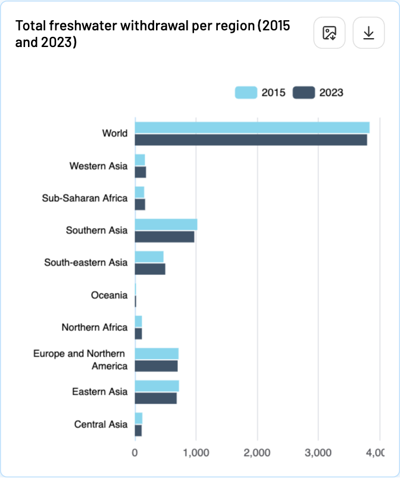

#### WU2 · Total water withdrawal per capita per region (2015 and 2023)
- **Type / view:** grouped bar · World only
- **Data:** `key=totalWaterWithdrawalRegionalPC`
- **Suggested map:** ✅ `twpc` choropleth with region outlines and hover-highlight.

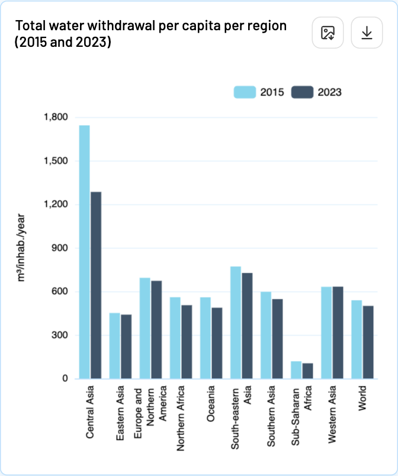

#### WU3 · Proportion of freshwater withdrawal by economic sector per region (2023)
- **Type / view:** horizontal 100 % stacked bar (Agriculture / Industry / Municipal) · World only
- **Data:** `key=totalFreshwaterWithdrawalByEconomicSectorRegional&year=`
- **Suggested map:** ✅ `aw_pct` choropleth. Better: ➕ a categorical "dominant sector" map, or a ternary colour map of the three sector shares, so all three series appear on the map.

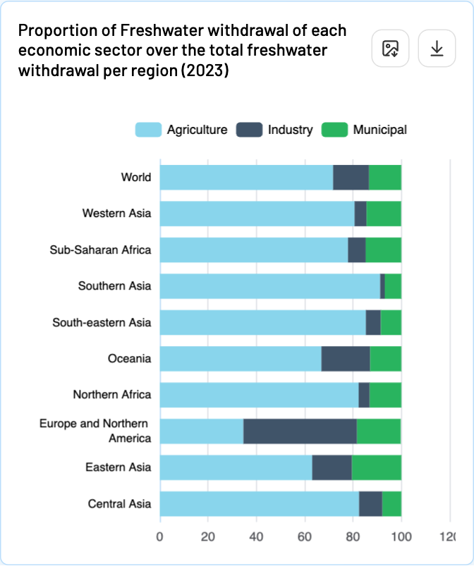

#### WU4 · Freshwater withdrawals by source per region (2023)
- **Type / view:** horizontal grouped bar (surface vs groundwater) · World only
- **Data:** `key=totalFreshwaterWithdrawalBySourceRegional&year=`
- **Suggested map:** ➕ "Groundwater share of freshwater withdrawal (%)" choropleth.

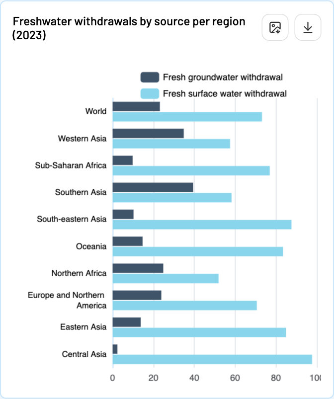

#### WU5 · Use of non-conventional water per region (2023)
- **Type / view:** grouped bar (desalinated vs treated municipal wastewater) · World only
- **Data:** `key=nonConventionalWaterPerRegion&year=`
- **Suggested map:** ➕ "Non-conventional water as % of withdrawal" choropleth. Alternatively, ➕ proportional symbols split into desalination and reused wastewater, since use is concentrated in a few countries.

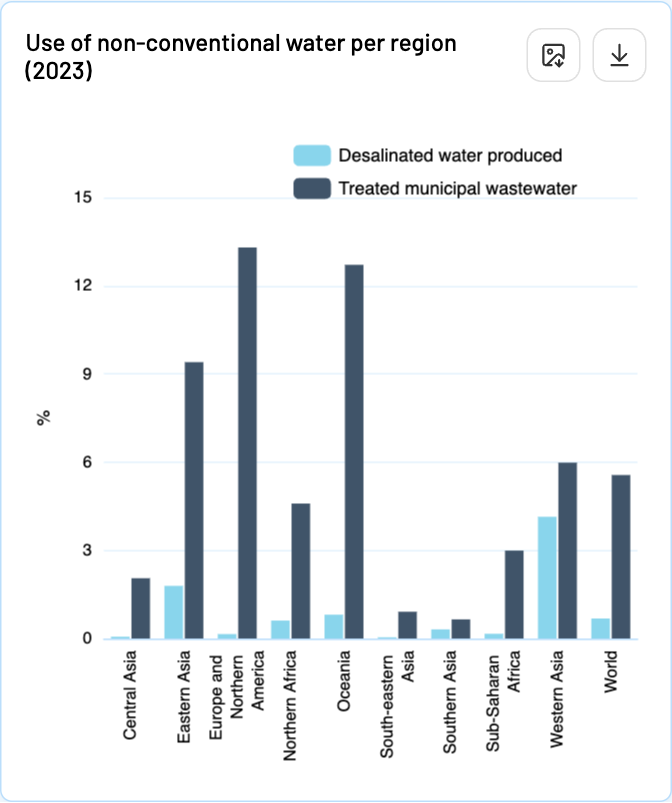

#### WU6 · Water withdrawal by economic sector (2023)
- **Type / view:** donut · World + Country
- **Data:** `snapshot`: *Agricultural / Industrial / Municipal water withdrawal*
- **Suggested map:** World view: ✅ `aw_pct`. Country view: ✅ switch to the sector-specific per-capita styles (`awpc` / `iwpc` / `mwpc`) when a slice is clicked. Optionally add the ✅ GAEZ "Share of irrigated land" raster (Local domain) to show where agricultural withdrawal happens.

| World | Egypt |
|---|---|
| 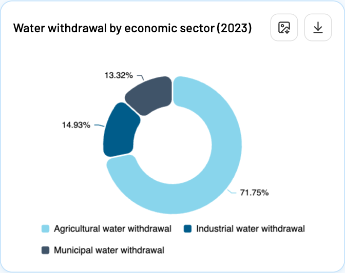 | 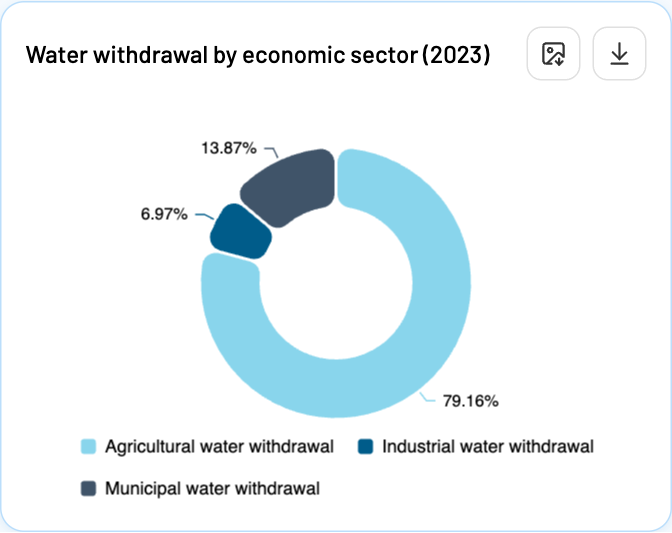 |

#### WU7 · Water withdrawal by source (2023)
- **Type / view:** donut (surface vs groundwater) · World + Country
- **Data:** `snapshot`: *Fresh surface water withdrawal*, *Fresh groundwater withdrawal*
- **Suggested map:** ➕ the same groundwater-share-of-withdrawal choropleth as WU4.

| World | Egypt |
|---|---|
| 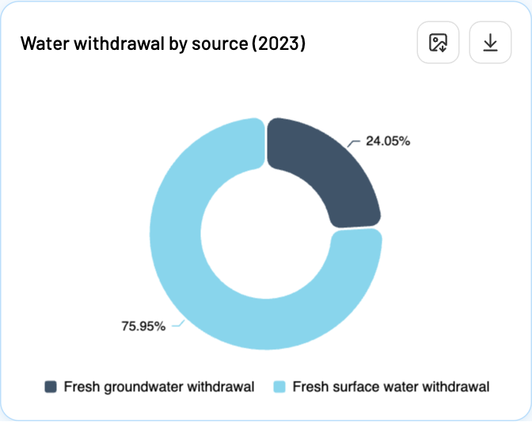 | 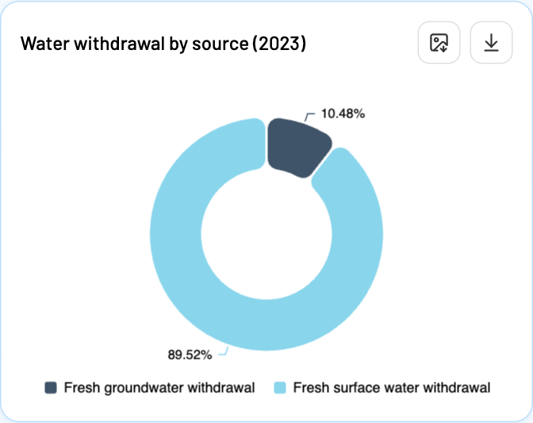 |

#### WU8 · Water withdrawal per capita (time series, from 2010)
- **Type / view:** grouped bar time series (total + 3 sectors) · World + Country
- **Data:** `multivariateTimeseries&fromYear=2010`: total, agricultural, municipal and industrial withdrawal per capita
- **Suggested map:** ✅ `twpc` choropleth with the time slider synced to the chart. Clicking a legend series switches to `awpc` / `iwpc` / `mwpc`.

| World | Egypt |
|---|---|
| 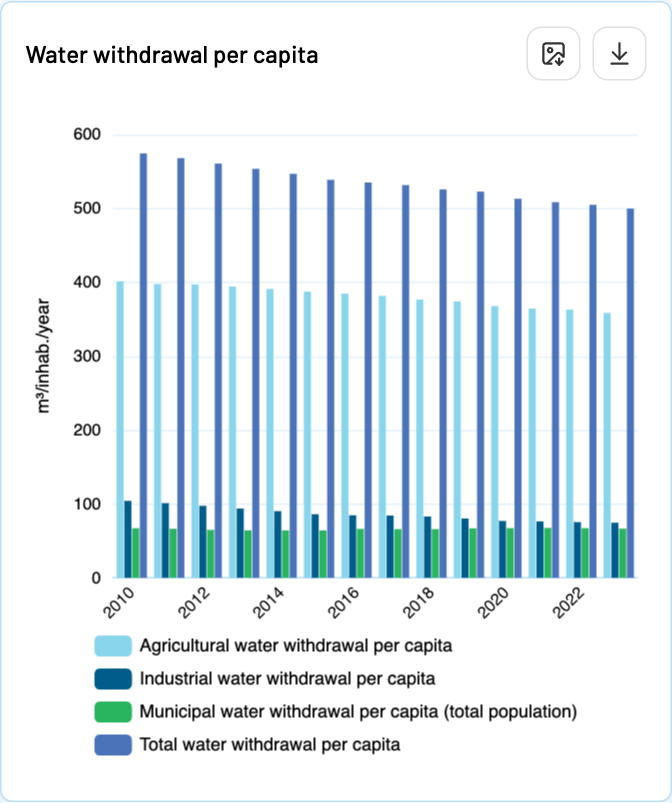 | 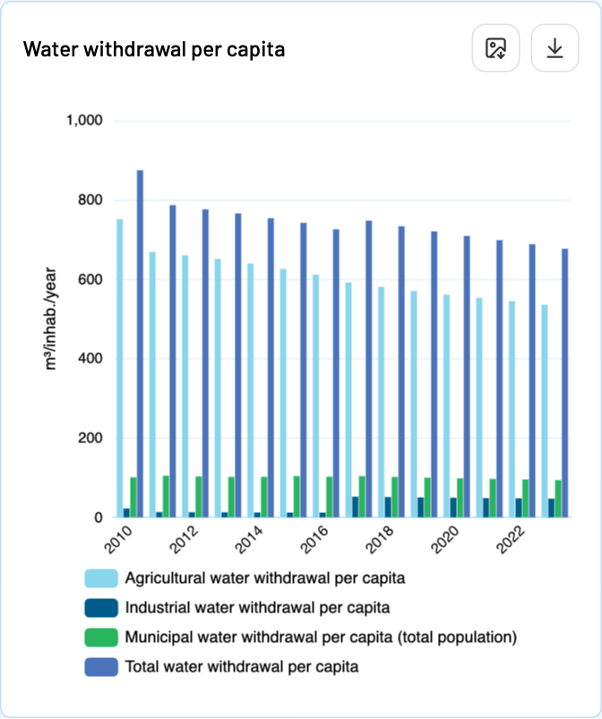 |

### 1.3 Irrigation tab

**Current map styles:** `aeit` (area actually irrigated, 1000 ha), `pct_ci` (% of cultivated area equipped for irrigation).
**Extra banner:** Total area equipped for irrigation (1000 ha).

#### IR1 · Top 10 countries with largest area equipped for full control irrigation (2023)
- **Type / view:** horizontal bar · World only
- **Data:** `key=topCountriesWithFullControlIrrigation&year=` (million ha)
- **Suggested map:** ➕ proportional circles of area equipped for full-control irrigation, with the top 10 highlighted. ✅ `aeit` is the closest existing style, but it shows *actually* irrigated area, not *equipped* area.

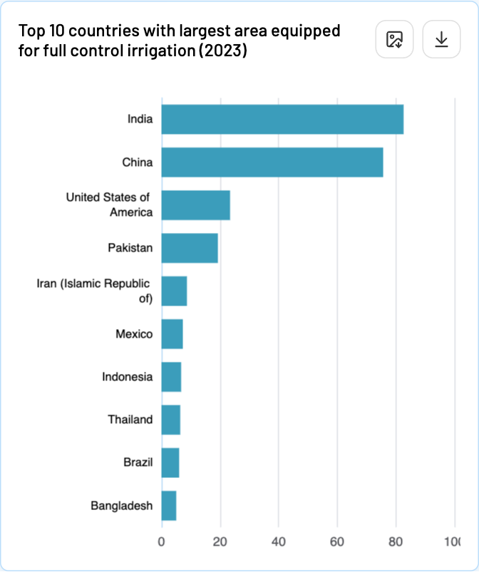

#### IR2 · Area equipped for full control irrigation by method per region (2023)
- **Type / view:** 100 % stacked bar (surface / sprinkler / localized) · World only
- **Data:** `key=irrigationMethodByRegion&year=`
- **Suggested map:** ➕ categorical "dominant irrigation method" per country, or ➕ "% sprinkler + localized" (pressurised irrigation) choropleth.

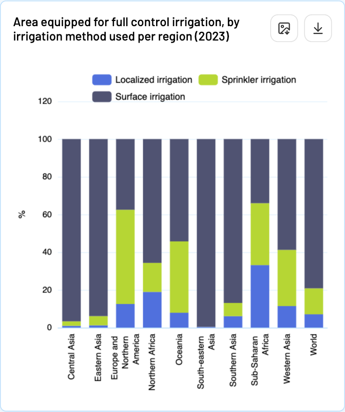

#### IR3 · % of cultivated area equipped for irrigation per region
- **Type / view:** multi-line (World + regions, from 2015) · World only
- **Data:** `key=irrigatedCultivatedAreaPercent&fromYear=2015&year=`
- **Suggested map:** ✅ `pct_ci` choropleth with time sync and region outlines. Hovering a line highlights its region.

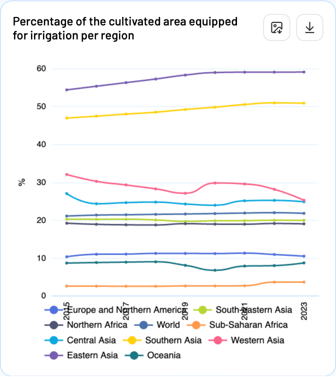

#### IR4 · Area equipped for irrigation by source
- **Type / view:** donut (surface / groundwater / mixed) · World + Country. ⚠️ It **did not render in World view**; the screenshot is for Egypt.
- **Data:** `snapshot`: *% of area equipped for irrigation by surface water / groundwater / mixed*
- **Suggested map:** ➕ "% irrigated by groundwater" choropleth. For a selected country, ✅ the GAEZ "Share of irrigated land" raster.

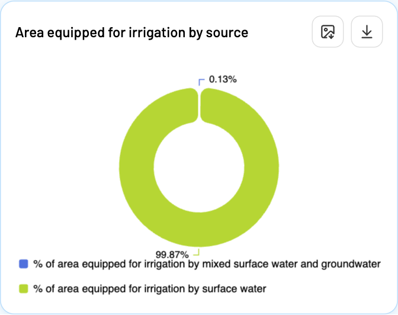

#### IR5 · Area equipped for irrigation: actually irrigated (time series)
- **Type / view:** line (million ha) · World + Country
- **Data:** `multivariateTimeseries`: *Area equipped for irrigation: actually irrigated*
- **Suggested map:** ✅ `aeit` with time sync. Better: ➕ "actually irrigated ÷ equipped (%)" (utilisation rate), which says more than absolute hectares on a choropleth.

| World | Egypt |
|---|---|
| 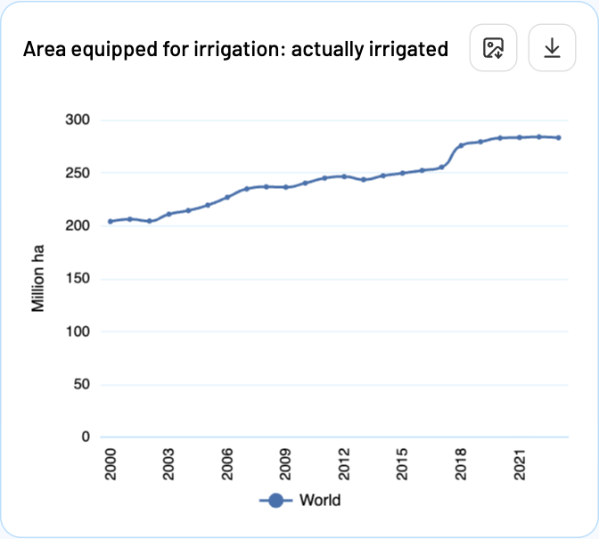 | 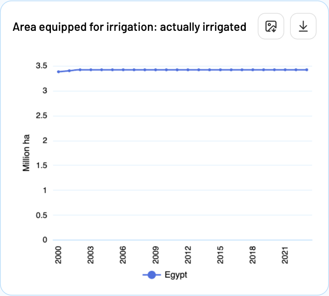 |

#### IR6 · Per capita crop area vs total cropland vs total irrigated
- **Type / view:** stacked bar + line on right axis · World + Country
- **Data:** `key=cropAreaPerCapitaVsTotalCroplandVsTotalIrrigated`. Series: area equipped for irrigation, cropland area, cropland per person.
- **Suggested map:** ➕ "Cropland per person (ha)" choropleth for the line, or ➕ "% of cropland equipped for irrigation". For a selected country, ✅ ESA WorldCover cropland (compare layer) plus ✅ the GAEZ irrigated-share raster.

| World | Egypt |
|---|---|
| 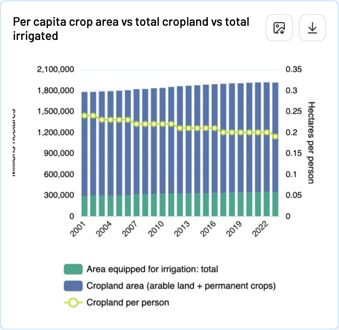 | 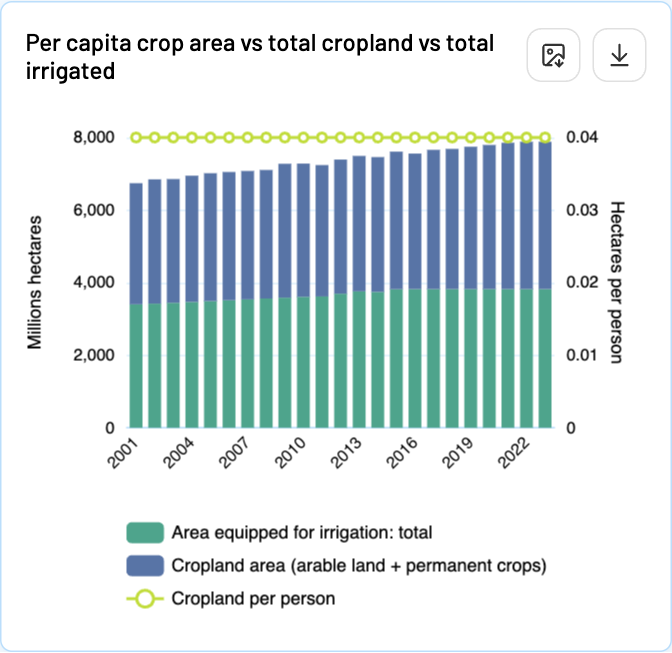 |

### 1.4 SDG 6.4 tab (default)

**Current map styles:** `ws` (6.4.2 water stress %, default), `wue` (6.4.1 USD/m³), `wue_pct_ch` plus the sectoral `iwue_pct_ch` / `iawue_pct_ch` / `swue_pct_ch`, and sectoral water stress `ascws` / `iscws` / `mscws`. The styles `iwue` / `iawue` / `swue` exist but are **hidden**.

#### SDG1 · Water stress per region (2015 and 2023)
- **Type / view:** grouped bar · World only
- **Data:** `key=waterStressPerRegion&year=`
- **Suggested map:** ✅ `ws` choropleth (already the default, so this is a good match). Add region outlines and hover-highlight.

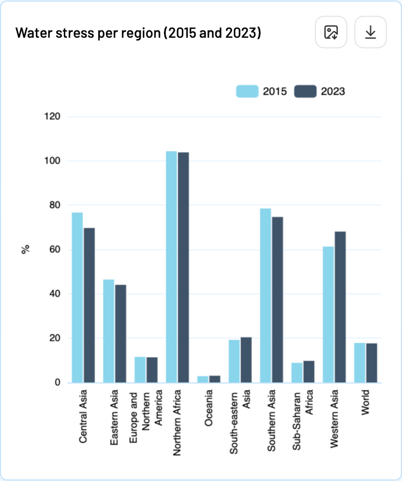

#### SDG2 · Countries facing critical and high levels of water stress (2023)
- **Type / view:** horizontal bar · World only
- **Data:** `key=topCountriesWaterStress&year=`
- **Suggested map:** ✅ `ws`, but emphasise only the ≥ 75 % classes (grey out the rest) and outline the listed countries. Most are small Gulf states.

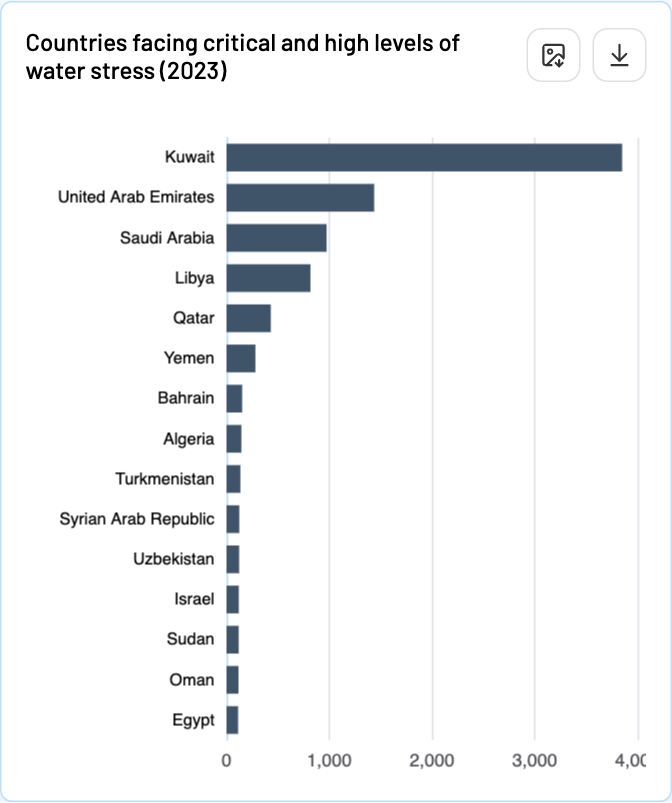

#### SDG3 · SDG 6.4.2 contribution to water stress (by sector)
- **Type / view:** grouped bar time series · World + Country
- **Data:** `multivariateTimeseries`: agricultural, industrial and municipal sector contribution to water stress
- **Suggested map:** ✅ the sectoral styles `ascws` / `iscws` / `mscws`, switched by clicking the legend. Optionally ➕ a "dominant contributing sector" categorical map.

| World | Egypt |
|---|---|
| 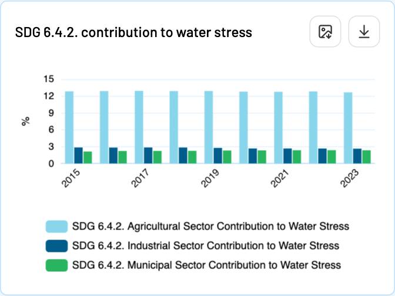 | 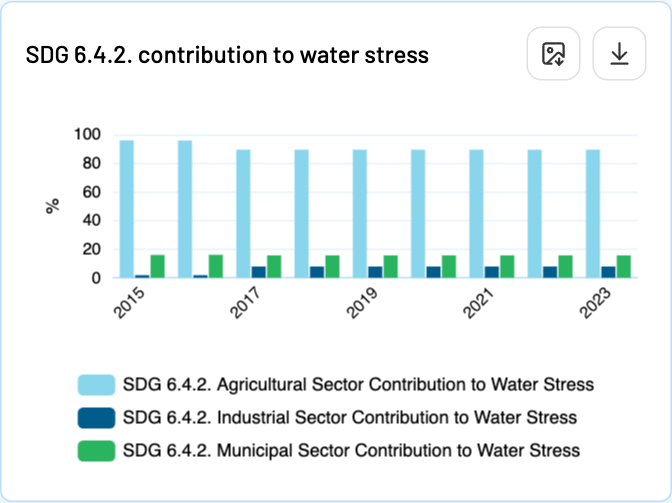 |

#### SDG4 · SDG 6.4.2 water stress trend
- **Type / view:** line · World + Country. With a country selected, it also plots its region and the World.
- **Data:** `multivariateTimeseries`: *SDG 6.4.2. Water Stress*
- **Suggested map:** ✅ `ws` with the time slider synced. Optionally ➕ "change in water stress 2015→2023 (pp)", a diverging style that mirrors the existing WUE-change style.

| World | Egypt |
|---|---|
| 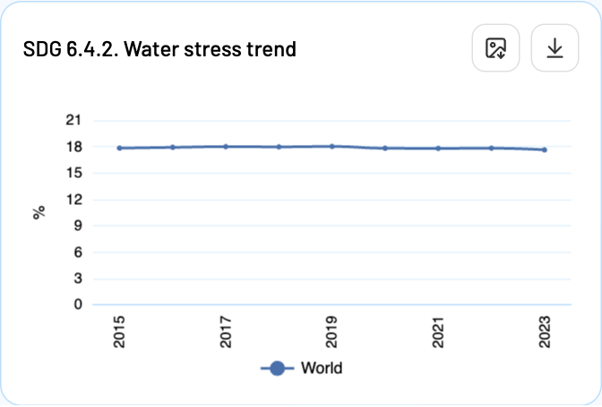 | 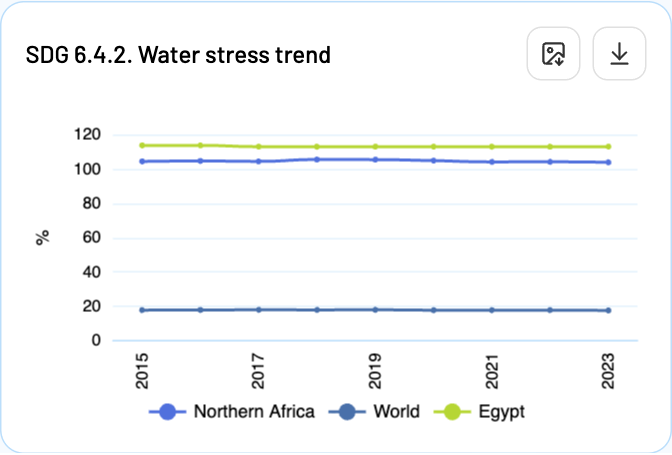 |

#### SDG5 · Water use efficiency (USD/m³) per region (2015 and 2023)
- **Type / view:** grouped bar · World only
- **Data:** `key=waterUseEfficiencyPerRegion&year=`
- **Suggested map:** ✅ `wue` choropleth with region outlines.

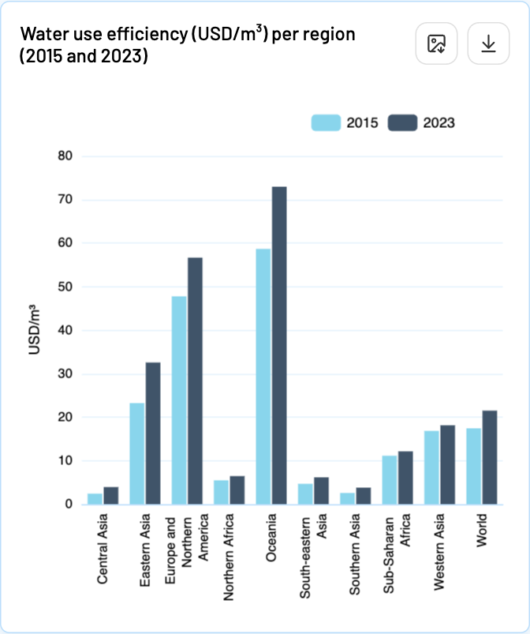

#### SDG6 · Water use efficiency in the agricultural sector per region (2015 and 2023)
- **Type / view:** grouped bar · World only
- **Data:** `key=waterUseEfficiencyInAgriculturePerRegion&year=`
- **Suggested map:** the `iawue` style (Irrigated agriculture WUE) already exists but is **hidden**. Un-hide it and use it here.

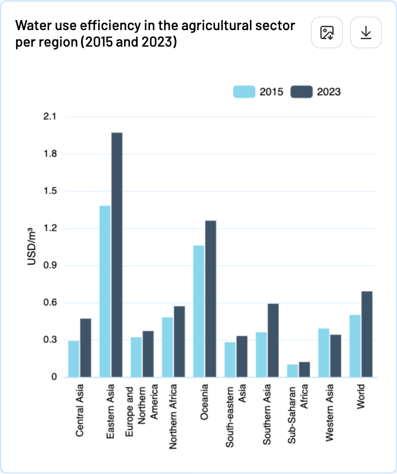

#### SDG7 · SDG 6.4.1 water use efficiency by sector
- **Type / view:** grouped bar time series · World + Country
- **Data:** `multivariateTimeseries`: industrial, irrigated agriculture and services WUE
- **Suggested map:** un-hide `iwue` / `iawue` / `swue` and switch between them from the legend. Their % change counterparts (✅ `*_pct_ch`) suit the comparison over time.

| World | Egypt |
|---|---|
| 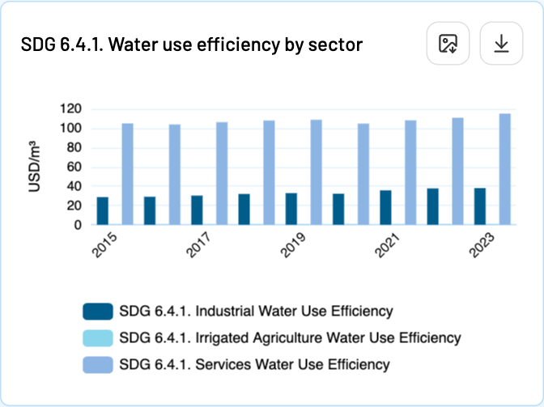 | 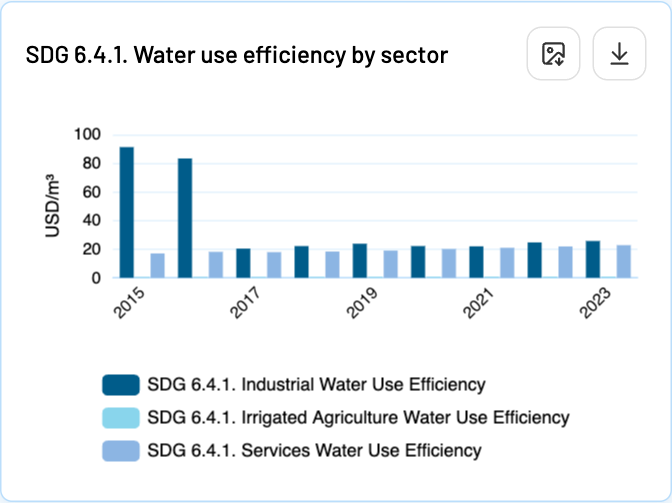 |

#### SDG8 · SDG 6.4.1 water use efficiency trend
- **Type / view:** line · World + Country (plus region and World when a country is selected)
- **Data:** `multivariateTimeseries`: *SDG 6.4.1. Water Use Efficiency*
- **Suggested map:** ✅ `wue_pct_ch` (% change 2015–2023) for the trend message, or ✅ `wue` with time sync.

| World | Egypt |
|---|---|
| 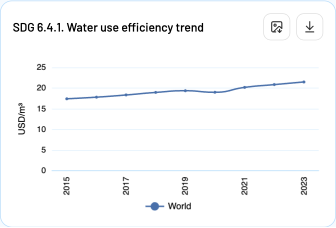 | 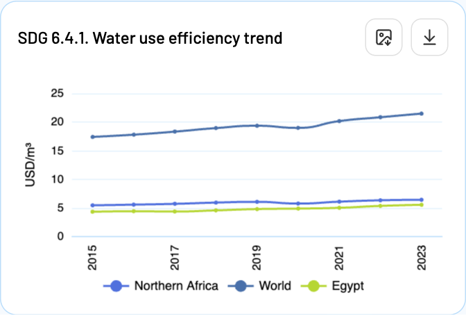 |

---

## 2. Basin domain

Basin charts use the from/to date range. **Current map styles** (Major Basins and Sub-basins, Monthly or Annual): precipitation, actual evapotranspiration (AET), mean discharge, and mean storage change ΔS. The most-used chart metric, **P − AET**, has **no map style**.

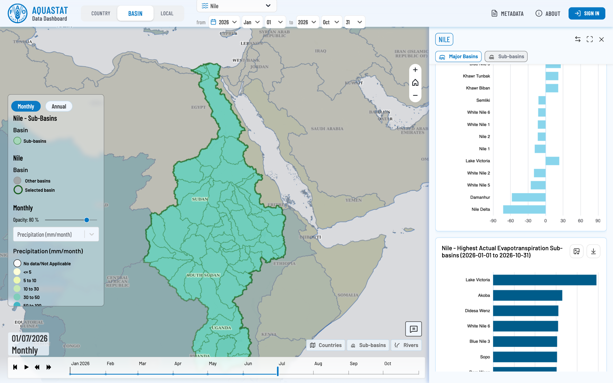

### 2.1 Major Basins tab, World view

#### MB1 · Wettest major basins (P − AET)
- **Type:** horizontal bar · World only · `key=wettestMajorBasins&fromDate&toDate` (mm)
- **Suggested map:** ➕ "P − AET (mm)" diverging choropleth of major basins (blue = surplus, brown = deficit), with the top 10 outlined. One new style would serve MB1, MB2, MB6, SB5 and SB6.

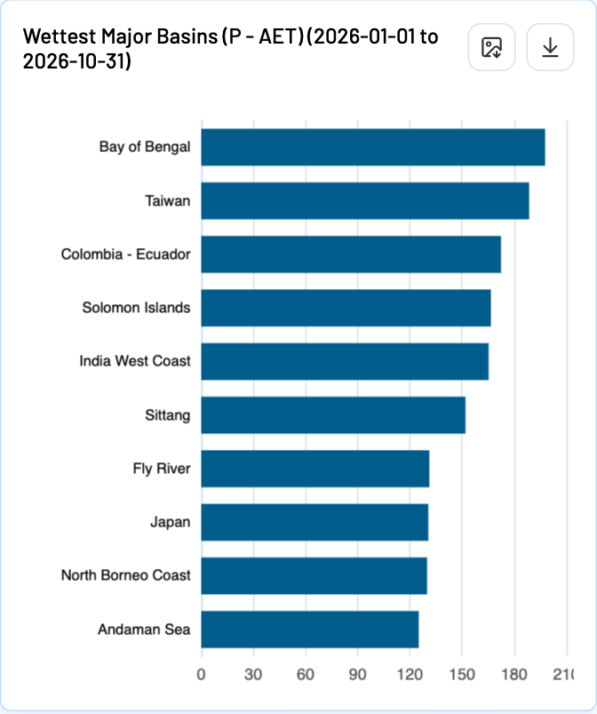

#### MB2 · Driest major basins (P − AET)
- **Type:** horizontal bar (negative values) · World only · `key=driestMajorBasins`
- **Suggested map:** ➕ the same P − AET diverging style, with the bottom 10 outlined.

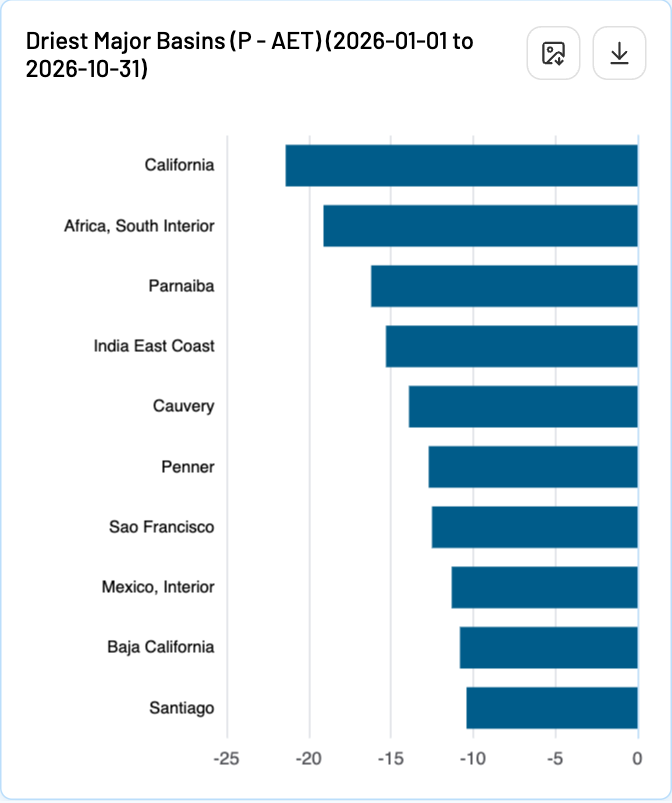

#### MB3 · Highest actual evapotranspiration (major basins)
- **Type:** horizontal bar · World only · `key=highestEvapotranspirationMajorBasins`
- **Suggested map:** ✅ evapotranspiration style (Annual, or Monthly summed over the range). The top 10 are outlined.

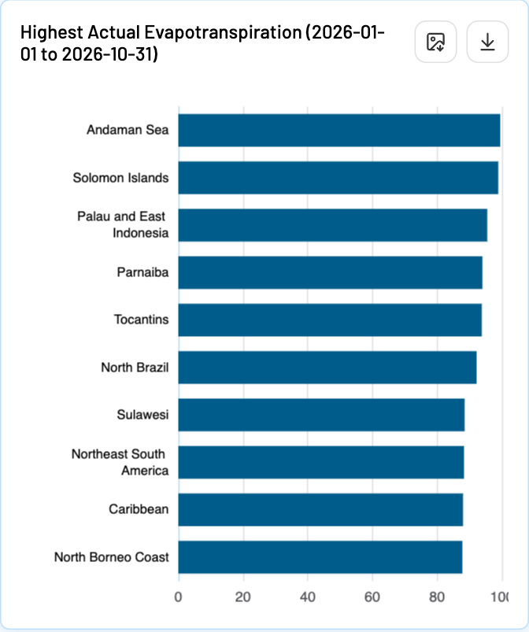

#### MB4 · Share of global precipitation volume
- **Type:** donut (top basins + "Other") · World only · `key=shareOfGlobalPrecipitationVolume`
- **Suggested map:** ➕ precipitation **volume** (km³) per basin as proportional symbols or a volume choropleth. The existing precipitation style is depth (mm), which ranks basins differently.

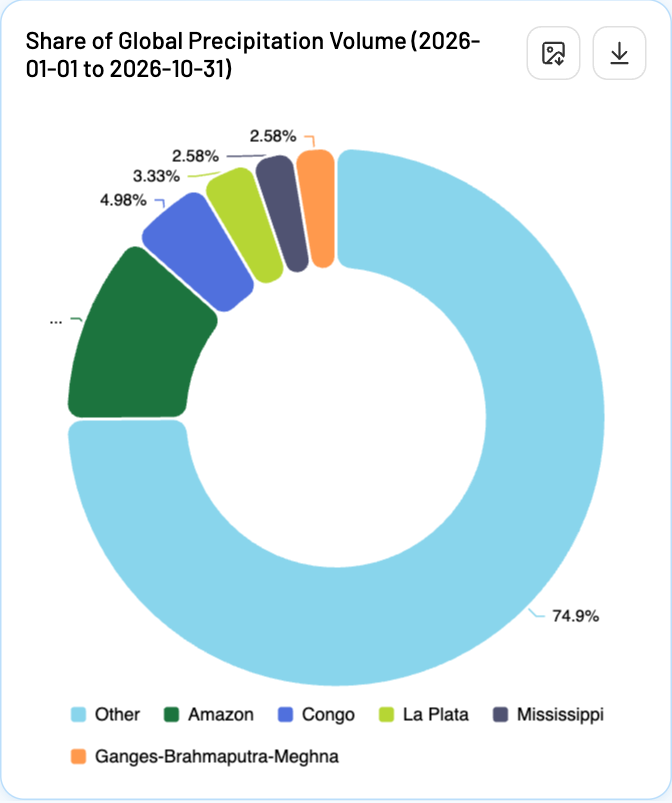

#### MB5 · Global precipitation, evapotranspiration and water balance (monthly cycle)
- **Type:** multi-line by month (P, AET, P − AET) · World only · `key=globalSeasonalWaterCycle`
- **Suggested map:** ✅ Monthly major-basin layer. Clicking a month on the chart sets the map's month (time sync), so you can play through the seasons.

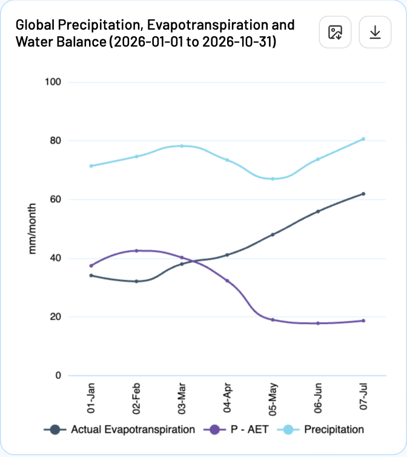

### 2.2 Major Basins tab, basin selected (Nile)

#### MB6 · {basin}: wettest to driest sub-basins (P − AET)
- **Type:** diverging horizontal bar · basin selected · `key=wettestDriestSubBasins&basinId=`
- **Suggested map:** ➕ P − AET diverging choropleth of the **sub-basins inside the selected basin**, zoomed to the basin. Hovering a bar highlights that sub-basin.

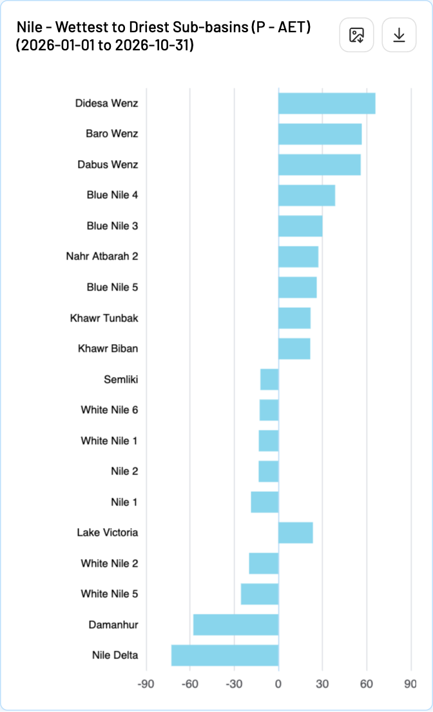

#### MB7 · {basin}: highest AET sub-basins
- **Type:** horizontal bar · basin selected · `key=highestEvapotranspirationSubBasins&basinId=`
- **Suggested map:** ✅ sub-basin AET style, clipped to the selected basin. Optionally the ✅ WaPOR AETI raster (Local domain) for detail.

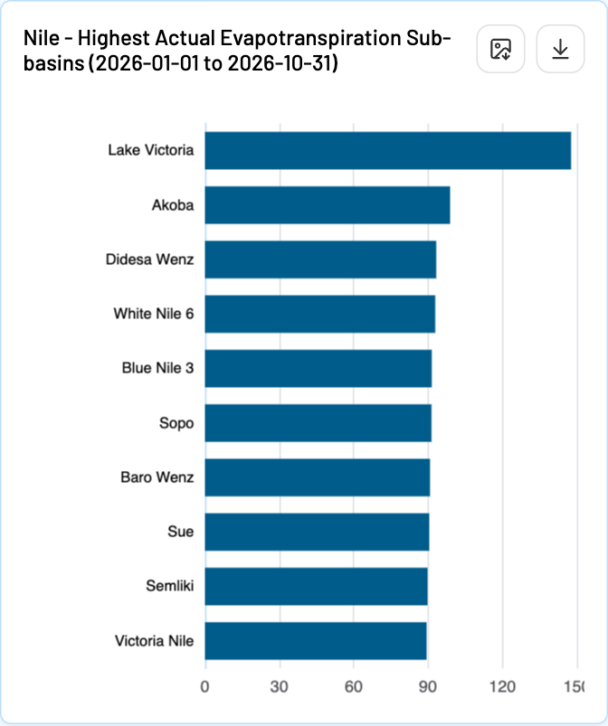

#### MB8 · {basin}: share of precipitation volume
- **Type:** donut · basin selected · `key=shareOfBasinPrecipitationVolume&basinId=`
- **Suggested map:** ➕ sub-basin precipitation volume (km³), or ✅ precipitation depth as a fallback, inside the basin.

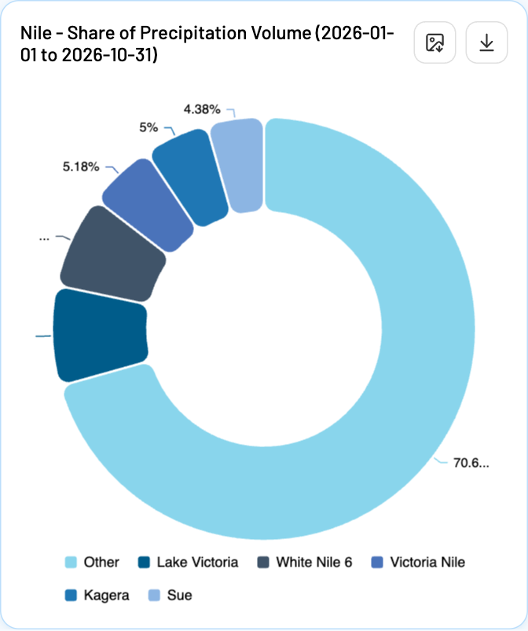

#### MB9 · {basin}: precipitation, ET and water balance (monthly cycle)
- **Type:** multi-line by month · basin selected · `key=basinSeasonalWaterCycle&basinId=`
- **Suggested map:** ✅ Monthly sub-basin layer clipped to the basin, with month sync, ideally showing ➕ P − AET.

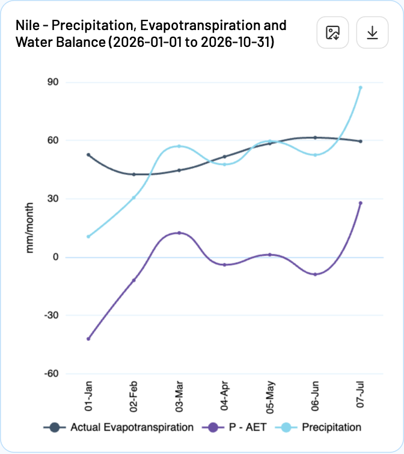

#### MB12 · {basin}: precipitation vs actual evapotranspiration
- **Type:** scatter (one point per sub-basin) with a 1:1 "AET = P" line · basin selected. It **does render**, despite its config flags.
- **Data:** `key=basinPrecipitationVsAet&basinId=` → {sub_basin, major_basin, precipitation_mm_year, aet_mm_year}
- **Suggested map:** ➕ "AET / P ratio" (evaporative index) choropleth of sub-basins: >1 means the basin draws on storage, inflow or irrigation. Hovering a point highlights its sub-basin.

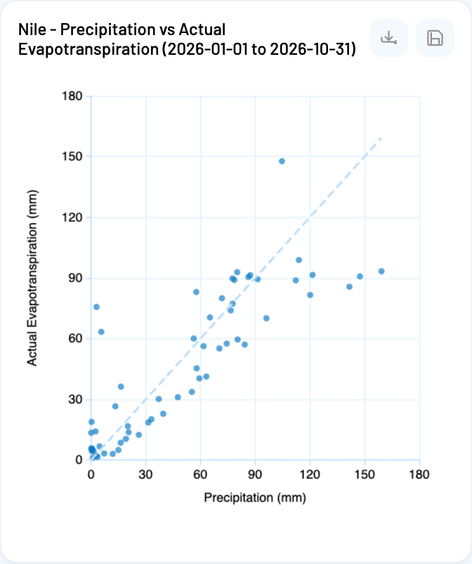

*MB10 / MB11 ({basin}: precipitation and ET time series, `basinPrecipitation` / `basinEvapotranspiration` with `{{basinId}}`) did **not render** when a major basin was selected. They only appear at sub-basin level (SB1/SB2).*

### 2.3 Sub-basins tab

#### SB1–SB4 · {sub-basin}: precipitation, evapotranspiration, discharge, storage change ΔS
- **Type:** line time series (dekadal) · sub-basin selected (Blue Nile 1)
- **Data:** `key=basinPrecipitation` / `basinEvapotranspiration` / `basinQDischarge` / `basinDeltaS` with `basinId=` → {date, value}
- ⚠️ Each legend shows two series ("Dekadal" and "Average"), but only one line is visible. The colours also swap between charts (green is "Average" in P but "Dekadal" in ET).
- **Suggested maps:**
  - SB1 Precipitation → ✅ AgERA5 dekadal precipitation raster (Local domain), clipped to the sub-basin and synced to the date clicked on the chart.
  - SB2 Evapotranspiration → ✅ WaPOR AETI dekadal raster, clipped and date-synced.
  - SB3 Discharge → ✅ Rivers layer, with line width scaled by `dis_av_cms` and the sub-basin outlet highlighted.
  - SB4 Storage change ΔS → ➕ sub-basin ΔS diverging choropleth (✅ `mean_delta_s_m3_sec` exists at sub-basin level), date-synced.

| | |
|---|---|
|  |  |
|  |  |

#### SB5 · Wettest sub-basins (P − AET), global
- **Type:** horizontal bar · World only · `key=globalWettestSubBasins`
- **Suggested map:** ➕ global P − AET diverging choropleth of sub-basins, with the top 10 outlined.

#### SB6 · Driest sub-basins (P − AET), global
- **Type:** horizontal bar · World only · `key=globalDriestSubBasins`
- **Suggested map:** ➕ the same diverging style, with the bottom 10 outlined. These are mostly small deltas and islands, so add a zoom-to or marker.

#### SB7 · Highest actual evapotranspiration (sub-basins), global
- **Type:** horizontal bar · World only · `key=globalHighestAetSubBasins`
- **Suggested map:** ✅ sub-basin evapotranspiration style, with the top 10 outlined.

*SB8 (global precipitation vs AET scatter, `globalPrecipitationVsAet`) did not render in any view. Its flags are `showOnWorld: false` and `showOnCountry: false`. If enabled, it would pair with the ➕ AET/P ratio map suggested for MB12.*

### 2.4 Rivers tab (hidden)
No charts. River network WMS layer and an attribute card.

---

## 3. Local domain

There are no configured charts, only raster layers (AgERA5 precipitation; WaPOR v3 AETI, RET, NPP, TBP and GBWP; GAEZ irrigated share; AQUASTAT dams). Each has a click-value card.

**On-demand openEO analysis (sign-in required, not screenshotted):** Precipitation → *Timeseries* and *Cumulative Timeseries* (zonal mean, sum, min and max over a drawn area). The result is shown as a line chart, or as a bar or pie depending on the result shape.
- **Suggested map:** the ✅ precipitation raster for the selected date, with the drawn area outlined and the chart's date synced to the raster time step.
- ⚠️ The analysis uses collection `WS-SURPLUS-YEARLY-AVG-G` (water surplus), not AgERA5 precipitation. This looks like a config error.

---

## Summary

| Domain · tab | Charts in config | Screenshotted | Not rendered / not captured |
|---|---|---|---|
| Country · Water resources | 5 | 5 | WR3, WR4 empty in World view |
| Country · Water use | 8 | 8 | — |
| Country · Irrigation | 6 | 6 | IR4 empty in World view |
| Country · SDG 6.4 | 8 | 8 | — |
| Basin · Major Basins | 12 | 10 | MB10, MB11 not shown when a major basin is selected |
| Basin · Sub-basins | 8 | 7 | SB8 (flags off) |
| Local | 0 (+ openEO analysis) | 0 | needs sign-in |

**New map styles that would cover most of the suggestions:**
1. **P − AET** diverging style for major basins and sub-basins (MB1, MB2, MB6, MB9, SB5, SB6).
2. **Groundwater share** of resources, withdrawal and irrigation (WR4, WU4, WU7, IR4).
3. **Un-hide the sectoral WUE styles** `iwue` / `iawue` / `swue` (SDG6, SDG7).
4. **Proportional-symbol layers** for absolute volumes and areas (WU1, IR1, MB4, MB8).
5. **Chart ↔ map time sync** for every time-series chart (WR5, WU8, IR3, IR5, SDG4, SDG8, MB5, MB9, SB1–SB4).
